# Project Roadmap & Implementation Milestones — FindIT

> **Current Status**: `MILESTONES 1 & 2 COMPLETED` | `MILESTONE 3 PENDING START`  
> **Frontend Design Status**: `COMPLETED IN GOOGLE STITCH & INTEGRATED`  
> **Backend & Integration Status**: `MILESTONES 1 & 2 RUNTIME & SUITE VERIFIED (127.0.0.1:8000)`  

---

## 1. Roadmap Overview & Phasing

The FindIT implementation roadmap is organized into 8 sequential milestones, moving from core foundation and extraction to dense vector retrieval, rank fusion, UI integration, and synchronization resilience.

```mermaid
gantt
    title FindIT Implementation Roadmap
    dateFormat  X
    axisFormat  Day %d

    section Foundation
    M1: Skeleton & Local Runtime       :m1, 0, 3
    M2: Directory Registration & Scan  :m2, after m1, 3

    section Core Pipeline
    M3: Extraction & Passage Chunking  :m3, after m2, 5
    M4: Semantic Index (FAISS)         :m4, after m3, 4
    M5: BM25 Lexical & RRF Fusion      :m5, after m4, 4

    section UI & Integration
    M6: Frontend UI & In-Place Search  :m6, after m5, 5
    M7: Sync Engine & Index Lifecycle  :m7, after m6, 4
    M8: Security Hardening & Polish    :m8, after m7, 3
```

---

## 2. Implementation Milestones

### Milestone 1 — Project Skeleton & Local Runtime
- **Scope**:
  - Initialize React + TypeScript + Vite frontend project structure.
  - Setup Python + FastAPI backend environment with strict loopback binding (`127.0.0.1`).
  - Configure SQLite database initialization with WAL mode.
  - Establish CORS allowlisting and `/api/health` diagnostic endpoint.
- **Exit Criteria**: Frontend client successfully communicates with the local FastAPI backend.

### Milestone 2 — Directory Registration & Scanning (`COMPLETED`)
- **Scope**:
  - Implement OS folder picker flow / directory registration endpoint.
  - Build directory scanner with path canonicalization and directory boundary validation.
  - Implement file discovery and file-type identification (PDF, PPTX, DOCX, MD, TXT, Code, Config).
  - Store registered directories in SQLite.
- **Exit Criteria**: User can register a local directory and view discovered document counts in the database.

### Milestone 3 — Extraction & Structure-Aware Passages
- **Scope**:
  - Implement format extractors with structural coordinate tracking:
    - PDF (`pypdf` / `pymupdf`): Page numbers and page counts.
    - PPTX (`python-pptx`): Slide numbers and titles.
    - Markdown & Plain Text: 1-indexed line ranges and heading paths.
    - DOCX: Section headings and paragraph indices.
  - Implement structure-aware chunking engine (~250–500 tokens, 20% overlap).
  - Persist extracted passages and source locations into SQLite `passages` table.
- **Exit Criteria**: Stored passages possess verifiable, trustworthy source location labels.

### Milestone 4 — Semantic Vector Indexing
- **Scope**:
  - Integrate `sentence-transformers/all-MiniLM-L6-v2` embedding model.
  - Generate 384-dimensional dense vectors and apply L2 normalization.
  - Construct and persist FAISS `IndexFlatIP` index.
  - Maintain `vector_id` $\leftrightarrow$ `chunk_id` mapping.
- **Exit Criteria**: Given a semantic query vector, FAISS returns the top-50 candidate chunk IDs with cosine similarity scores.

### Milestone 5 — BM25 Lexical Retrieval & Reciprocal Rank Fusion
- **Scope**:
  - Build BM25 inverted term index over passage texts.
  - Implement BM25 query execution returning top-50 lexical candidate chunks.
  - Implement Reciprocal Rank Fusion ($k=60$) combining FAISS and BM25 candidate ranks.
  - Implement Top-10 pagination and batch retrieval logic.
- **Exit Criteria**: Single query produces a unified hybrid-ranked list of top passages.

### Milestone 6 — Frontend UI & Continuous Search Transition
- **Scope**:
  - Implement the established visual design: warm ivory background, terracotta contours, clean typography.
  - Build the smooth 350–500ms in-place transition from Homepage to Results view.
  - Render unified passage result cards with filename, location badge, and path.
  - Build in-app Passage Inspector modal rendering full extracted text and query highlights.
  - Implement native OS "Open in folder" bridge.
- **Exit Criteria**: End-to-end search query from UI returns real passages with working inspection and folder opening.

### Milestone 7 — Sync Engine & Index Lifecycle
- **Scope**:
  - Implement incremental sync detecting added, modified, and deleted files via size and timestamps.
  - Build atomic index update and prune pipeline.
  - Implement index-only directory removal guaranteeing source file immutability.
  - Surface real backend pipeline stages and progress counts in UI.
- **Exit Criteria**: Repeated file modifications and directory removals leave the indices clean and synchronized.

### Milestone 8 — Security Hardening & Acceptance Verification
- **Scope**:
  - Validate directory boundary confinement and symlink traversal defenses.
  - Verify origin headers and CSRF protections for local service calls.
  - Run benchmark test query suite and verify search latency under 500ms.
  - Verify complete acceptance checklist.
- **Exit Criteria**: All acceptance criteria pass and system is ready for v0.1.0 release.

---

## 3. Acceptance Verification Checklist

### UI & Interaction
- [ ] Homepage matches established visual design (ivory canvas, terracotta contours).
- [ ] Pressing `Enter` executes smooth in-place header animation (350–500ms) without page reload.
- [ ] Query remains preserved and editable in the compact header.
- [ ] Results view presents one unified hybrid list (no separate technical mode tabs).
- [ ] Respects `prefers-reduced-motion` preferences.

### Search & Retrieval
- [ ] Local embedding model produces 384D normalized vectors.
- [ ] FAISS (`IndexFlatIP`) and BM25 candidate pools are fused via RRF ($k=60$).
- [ ] Initial search displays top-10 passages with functional "Show more" batching.
- [ ] Multiple passages from the same document can appear independently.
- [ ] Clicking a result card opens the in-app Passage Inspector with faithful text.
- [ ] Source location coordinates (Page X of Y, Slide N, Lines X–Y) are accurate.
- [ ] "Open in folder" opens the native file explorer without opening the passage modal.

### Indexing & Reliability
- [ ] Indexing progress indicates real stages and real file counts.
- [ ] Removing a directory removes internal index records only; original files are untouched.
- [ ] Incremental sync updates modified files and purges deleted documents.
- [ ] Local API binds strictly to `127.0.0.1` and blocks traversal outside approved roots.
- [ ] No document content or queries are transmitted to external cloud services.

---

## 4. Future Backlog (v2.0+)

1. **Optical Character Recognition (OCR)**: Integrate local Tesseract / Apple Vision OCR for scanned, non-text PDFs.
2. **Direct Document Navigation**: Open native PDF viewers at exact page/bounding-box highlight coordinates.
3. **Filesystem Watching**: Real-time event-driven background sync via `watchdog` or OS file events.
4. **Approximate Vector Search (HNSW / IVF)**: Evaluate if corpus size exceeds 100,000 passages.
5. **Additional File Formats**: Support for EPUB, Jupyter Notebooks (`.ipynb`), and spreadsheets (`.xlsx`).
